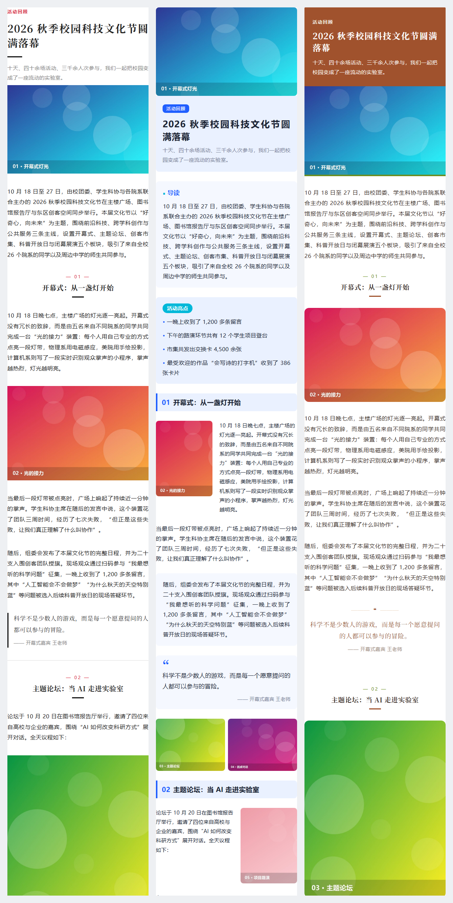

# XIUMI AI Studio

可视化微信公众号图文编辑器 + AI 自动排版。三栏编辑（模块/素材/模板/项目 · 手机画布 · 样式/主题/AI/参考风格），所有编辑与 AI 修改都作用在结构化文档 JSON 上，由专用编译器输出全内联样式的微信 HTML。

## 快速开始（Windows）

需要 Node.js ≥ 22 与 pnpm。

```bash
pnpm install
pnpm sample   # 生成验收样例：约 2000 字活动推文 + 10 张图
pnpm dev      # http://localhost:5173 （API 在 127.0.0.1:5174）
```

生产方式运行：`pnpm build` 后 `pnpm start`，访问 http://127.0.0.1:5174 。也可双击 `start.bat`。

可选配置：复制 `.env.example` 为 `.env`，填写大模型（DeepSeek / MiMo / MiniMax 等 OpenAI 兼容接口，或 Anthropic）与公众号 AppID/AppSecret。不配置时使用内置规则排版，复制粘贴发布不受影响。

验收样例（约 1,900 字 + 10 张图）自动生成的三套版式（E2E 截图基线，左起：叙事长文 / 信息卡片 / 图集故事）：



## 功能

| 功能 | 说明 |
|---|---|
| 13 种模块 | 封面、章节标题、正文、卡片、引言、图文分栏、单图、相册、时间轴、数据表、人物介绍、分割装饰、结尾署名；拖拽插入/排序、复制、收藏为模板 |
| 富文本 | 双击正文类模块就地编辑（tiptap），加粗/斜体/下划线/高亮/主题色/列表/居中/链接 |
| AI 模型设置 | 工具栏「⚙ AI 模型」：DeepSeek、通义千问、Kimi、智谱、豆包、MiniMax、MiMo、OpenAI、Claude、Gemini、OpenRouter、硅基流动、Ollama 或任意 OpenAI 兼容接口；可保存多套、一键切换、测试连接；密钥只存本机并打码显示 |
| AI 一键排版 | 导入 Word/Markdown/TXT + 照片 → 结构抽取 → **AI 设计三套方案**（模型决定配色、衬线/无衬线、字号行距、模块风格和逐章节版式，可填写风格要求、重新设计）+ 三套内置版式 |
| 导入公众号推文 | 工具栏「⤓ 导入推文」：粘贴文章链接或复制正文粘贴；**保留原样式**（拆成可拖动、双击改字、可换图的“原文片段”）或**提取内容重新排版**；可同时保存为模板、提取配色为主题。导入前需勾选确认版权 |
| 5 套主题 | 清华紫、科技蓝、人文暖色、极简杂志、青春活力；颜色/字号/行距/间距/圆角可微调并另存 |
| AI 设计助手 | 自然语言指令 → 操作列表（insert/update/remove/move/setTheme）→ 差异审阅，逐条接受/拒绝；另有 4 个离线规则动作 |
| 参考风格学习 | 对有权使用的文章提取颜色、字号层级、行距、间距、圆角、装饰倾向，生成新的原创主题 |
| 素材 | 上传自动纠正方向并压缩、裁剪另存、相册按统一比例智能裁切、封面设计器（900×383） |
| 项目 | 自动保存、历史版本（50 个）、撤销/重做（Ctrl+Z / Ctrl+Y）、模板收藏 |
| 导出 | Markdown、编辑器 JSON、微信 HTML、富文本剪贴板（内嵌图片 / 上传微信图床 / 原链接） |
| 草稿箱 | 配置公众号接口后，二次确认才会上传图片并创建草稿（不会群发） |

## 测试

```bash
pnpm check   # ESLint + TypeScript + Vitest 单元测试
pnpm e2e     # Playwright：验收流程 + 剪贴板 + 截图回归（首次运行生成基线）
```

**微信兼容性**：自动化测试只覆盖静态规则、HTML 结构与剪贴板内容；**尚未在真实公众号后台粘贴验证**。请按 [docs/03-wechat-compat-test.md](docs/03-wechat-compat-test.md) 人工测试并记录。

## 目录

```
src/core/      文档模型、主题、编译器、版式配方、结构抽取、ops、风格提取（无 UI 依赖，可单测）
src/editor/    React 编辑器
server/        Express：项目/版本/模板/主题落盘、素材(sharp)、导入(mammoth)、AI 代理、微信接口
tests/         unit（vitest）与 e2e（playwright）
docs/          调研选型、兼容测试、多 Agent 流程
data/          本地数据（不入库）
```

## 文档

- [P0 调研与技术选型](docs/01-research.md)
- [微信兼容性测试](docs/03-wechat-compat-test.md)
- [多 Agent 协作流程](docs/04-multi-agent-workflow.md)
- [第三方声明](THIRD_PARTY_NOTICES.md)
